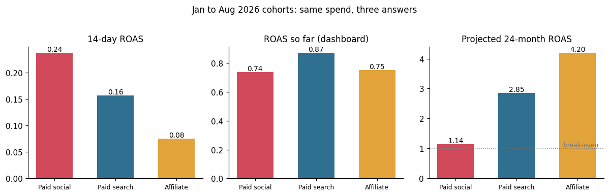
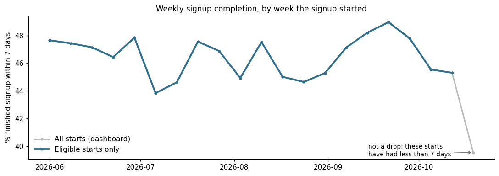
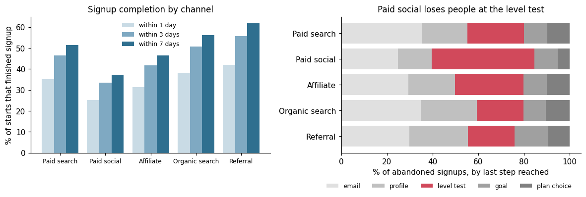
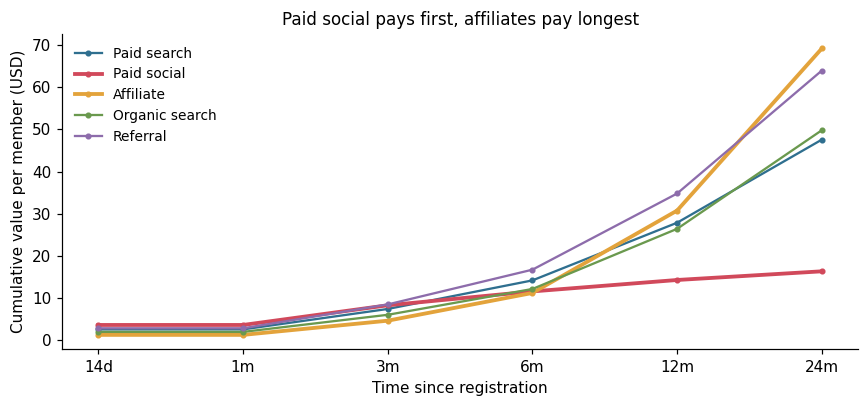
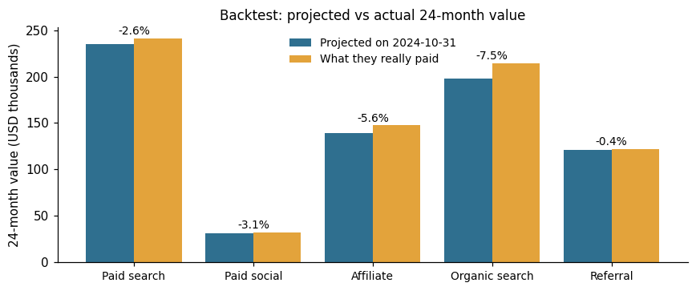

# Which channel really pays back? Funnel, ROAS and 24-month value projection

A growth team has to split its ad budget across paid search, paid social and affiliates. This case study builds the reporting behind that decision: a signup funnel by UTM source, ROAS by channel, and a projection of each cohort's 24-month value, checked with a backtest. Built as a dbt project on DuckDB, with seeds and data tests.

> **Everything in this repository is synthetic.** The app, the channels, the members, the spend and every number are invented and generated by `data/generate.py`. The generator also writes each member's true 24-month value, so the projection can be checked against the truth.



## The setting

A language learning app with a free tier and a monthly subscription (USD 12.99). People land on the signup page from five channels, go through a 5-step signup (email, profile, level test, goal, plan choice), and some of them pay. Paid social was scaled up in 2026. Data runs from January 2022 to 2026-10-25.

The question: **which paid channel should get more budget?**

## 1. The funnel: by UTM source, and only counting eligible starts

**UTM cleanup first.** The same source arrives as `google`, `Google` and `google%20`, and the same medium as `cpc` and `CPC`. `stg_signup_starts` parses the UTM parameters from the landing URL, decodes, trims and lower-cases them, and a dbt seed (`utm_channel_map.csv`) maps each clean source and medium pair to a channel. Here, 15 raw pairs map to 5 channels. A data test fails the build if more than 1% of tagged starts do not map, which is how a new partner nobody mapped gets caught.

**The trap:** a start from three days ago cannot have finished "within 7 days" yet. A dashboard that divides by every start shows a drop in the latest week, every week.



Counting only eligible starts (started at least N days before the data ends), the latest full week sits at 45.3%. The dashboard version shows 39.5% for the current week, a 6-point "drop" that is only time.

| Channel | Finished within 1 day | 3 days | 7 days | Most common last step for those who never finished |
|---|---|---|---|---|
| Referral | 42.1% | 55.6% | 61.9% | email (30%) |
| Organic search | 38.1% | 50.7% | 56.1% | email (35%) |
| Paid search | 35.2% | 46.5% | 51.6% | email (35%) |
| Affiliate | 31.3% | 41.9% | 46.6% | level test (30%) |
| Paid social | 25.3% | 33.6% | 37.3% | **level test (45%)** |



Paid social brings the least committed visitors, and almost half of the ones who give up do it at the level test. That is a product question (make the test skippable for that audience?) more than a media one.

## 2. Value: fast start, slow burn



Each point is the average cumulative value per member at 14 days, 1, 3, 6, 12 and 24 months, using only members old enough for that window. Paid social members pay first and stop early. Affiliate members start slowly and keep paying.

## 3. ROAS: three methods, three rankings

Cohorts registered from January to August 2026, which all have a full 14-day window:

| Channel | Spend per member | 14-day ROAS | ROAS so far (dashboard) | Projected 24-month ROAS |
|---|---|---|---|---|
| Paid social | USD 15.26 | **0.24** | 0.74 | 1.14 |
| Paid search | USD 16.75 | 0.16 | **0.87** | 2.85 |
| Affiliate | USD 16.59 | 0.08 | 0.75 | **4.20** |

- **14-day ROAS** rewards whoever pays first. It ranks paid social first.
- **ROAS so far** divides everything paid to date by spend. It mixes a January cohort (10 months of payments) with an August one (2 months), so it penalizes slow channels and recently scaled ones.
- **Projected 24-month ROAS** is what each channel is worth. Paid social barely breaks even, affiliates return more than 4 times their spend.

**How the projection works:** chain ladder, borrowed from insurance reserving. For each channel, the growth factor from one window to the next (for example 6 to 12 months) is measured on members old enough for both windows. Each member's value at the latest window that has fully passed is multiplied by the factors still to come. It works on totals: a member with zero value so far projects to zero, but the factors already include the late payers in the cohorts they come from.

## 4. Does the projection hold up? A backtest

The same models run a second time as if today were 2024-10-31 (`backtest_as_of` in `dbt_project.yml`), projecting the November 2023 to October 2024 cohorts. Those cohorts now have their full 24 months, so the projection can be compared with what they really paid.



| Channel | Backtest error | Today's projection error (Nov 2025 to Oct 2026 cohorts, against the generator's truth) |
|---|---|---|
| Paid search | -2.6% | -2.7% |
| Paid social | -3.1% | -0.4% |
| Affiliate | -5.6% | -3.0% |
| Organic search | -7.5% | +0.6% |
| Referral | -0.4% | +0.5% |

In the backtest the 12-to-24-month factor comes from only 10 monthly cohorts (2022), which is why the errors are a bit larger and all on the low side. More history makes it tighter.

**Readout:** shift budget from paid social to affiliates and paid search. If paid social stays, judge it on projected 24-month value, not on 14-day ROAS, and fix the level test drop-off before buying more of that traffic.

## The dbt project

| Piece | What it does |
|---|---|
| `vars` in `dbt_project.yml` | The as-of date, the backtest date and the unmapped-UTM threshold |
| `seeds/` | UTM to channel map, ad platform to channel map, value windows (14 days to 24 months) |
| `models/staging/` | Typed views, UTM parsing and cleanup, channel attribution |
| `models/funnel/` | Eligibility flags, completion by channel and by week, last step, UTM audit |
| `models/value/` | Value windows per member, growth factors, projection, cohort ROAS, channel summary |
| `tests/` | No payment before registration, signup finished after it started, value never decreases with a longer window, unmapped UTM share under the threshold |

Generic tests (`unique`, `not_null`, `relationships`, `accepted_values` and a custom `unique_combination`) cover keys, joins and categories. `dbt build` runs all 39 nodes (seeds, models and tests) and stops on any failure before a number is used.

## Limitations

- **Spend is matched to members by month.** Spend in a month is divided by the members who registered from that channel in the same month. Signups that finish days later can cross a month boundary.
- **One touch per member.** The channel is the UTM of the signup visit. Multi-touch attribution would credit the ad seen a week earlier.
- **Revenue, not margin.** ROAS here uses subscription revenue. A real budget decision would use contribution margin after app store fees and refunds.
- **The projection assumes new cohorts behave like old ones.** When a channel is scaled up quickly, the extra traffic is usually worse than the first. Watch the early windows of new cohorts against the curve.

## Run it

```bash
pip install -r requirements.txt
python data/generate.py      # synthetic data, about 30 MB in data/raw/
python run_analysis.py       # dbt build (seeds, models, tests), then the readouts and the projection checks
```

`notebook.ipynb` runs the same steps and draws the charts. To browse the models and their lineage: `dbt docs generate --profiles-dir . && dbt docs serve --profiles-dir .`

## Stack

dbt (dbt-duckdb), SQL (DuckDB), Python (pandas, matplotlib). Built with AI assistance (Claude Code); the study design, the checks and the conclusions are mine.
